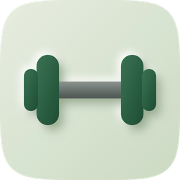
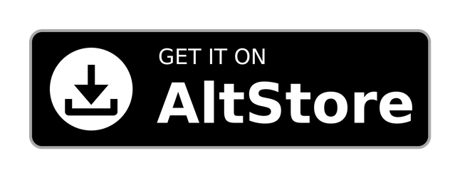
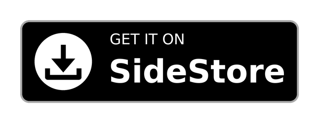
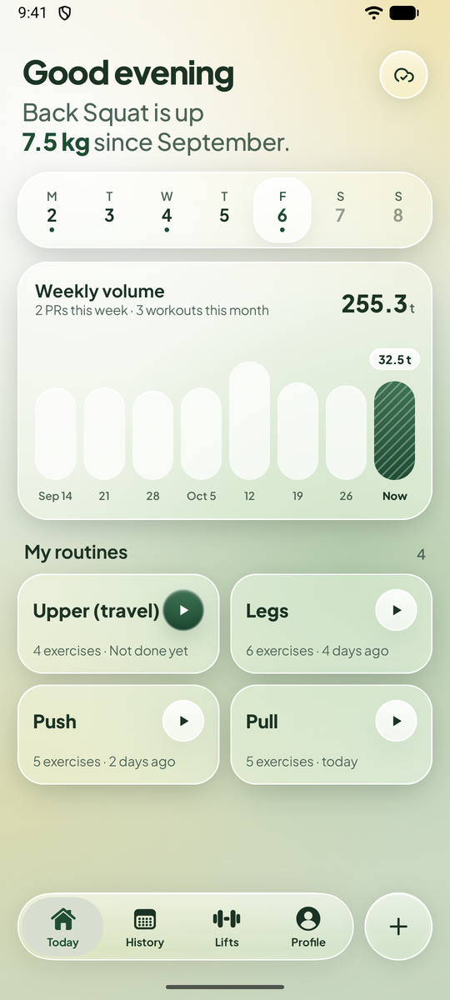
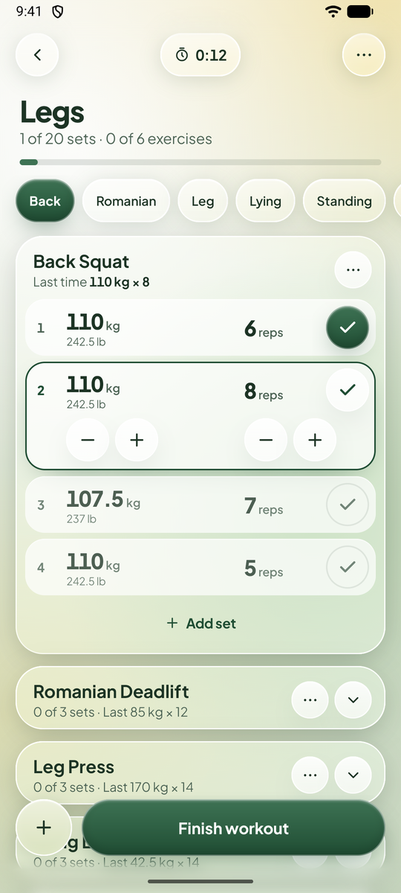
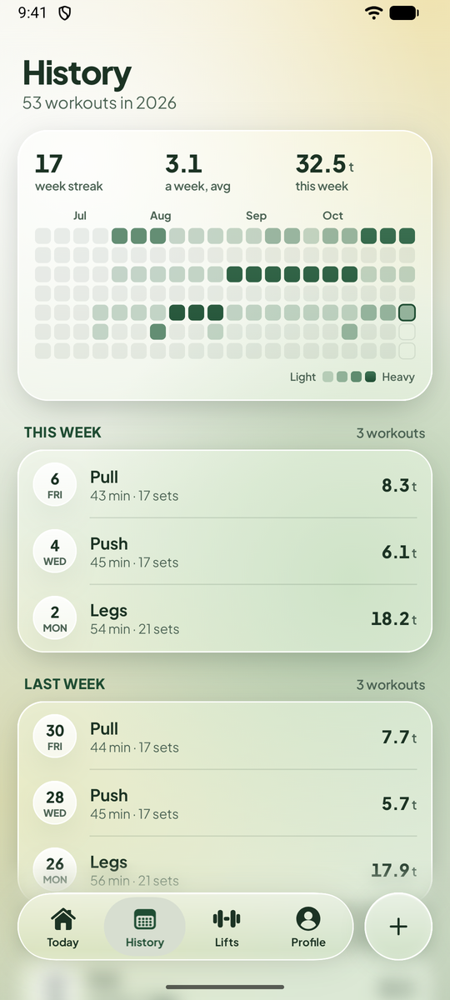
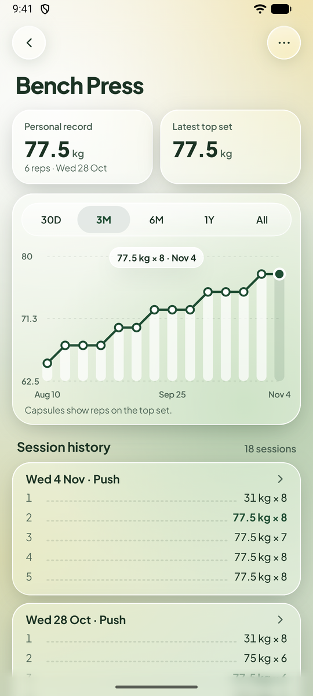
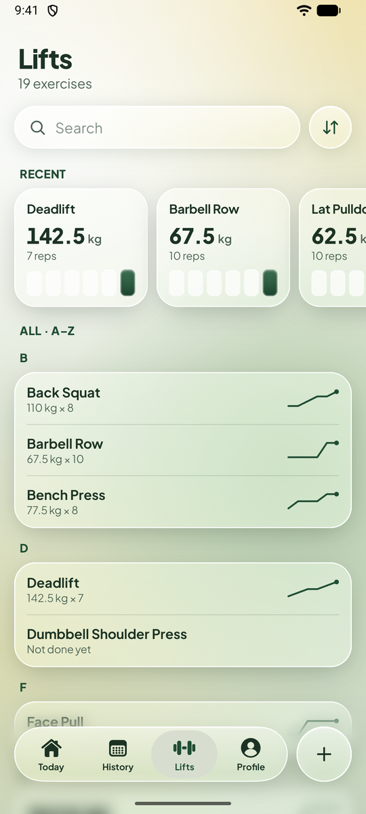
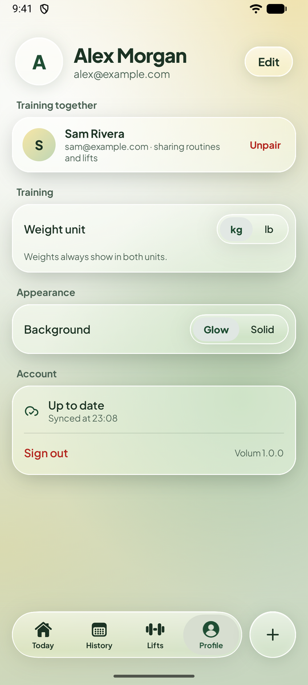

<div align="center">



# Volum

**A strength training log for iOS and Android.**

Build a routine once, then follow it session by session with the previous session's weights and
reps filled in, so logging is mostly confirming and adjusting numbers.

[](https://github.com/southstar21dev/Volum/actions/workflows/ci.yml)
[](https://github.com/southstar21dev/Volum/releases/latest)


<a href="https://apps.obtainium.imranr.dev/redirect?r=obtainium://add/https://github.com/southstar21dev/Volum"></a>
<a href="https://github.com/southstar21dev/Volum/releases/latest"></a>
<a href="https://southstar21dev.github.io/Volum/"></a>
<a href="https://southstar21dev.github.io/Volum/"></a>

<br />






</div>

## Why Volum

Most gym apps make you type every number, every set, every time. In practice you lift roughly what
you lifted last time, plus a little. Volum starts from there.

- **Last time, already filled in.** Starting a routine copies the previous session's weights and
  reps into every set. Tap the tick, nudge a number, move on.
- **Progress you can read.** Every lift gets its best set, a chart of top sets over time, and a
  plain sentence on the home screen when something goes up.
- **Train together.** Pair with a partner to share routines and lifts, and follow each other's
  session live.
- **Works offline.** Everything is saved on your phone first and synced in the background, so a
  basement gym with no signal is fine.
- **A calm, glassy interface.** One Compose Multiplatform codebase on Android and iOS, with soft
  Liquid Glass surfaces.

## Features

<table>
<tr>
<td width="50%" valign="top">

### Today at a glance
The week's training days, your weekly volume against the last two months, and your routines one
tap away. The headline tells you which lift has moved since last month.

</td>
<td width="50%" valign="top">

### Log a session fast
Sets come pre-filled from last time, with weights shown in kg and lb. Mark warm-up and drop sets,
log timed exercises like planks in seconds, skip an exercise for today, and run a stopwatch.

</td>
</tr>
<tr>
<td align="center"></td>
<td align="center"></td>
</tr>
<tr>
<td width="50%" valign="top">

### History
A streak, your average sessions per week and a heatmap of the last few months, followed by every workout
grouped by week with its duration, sets and total volume. Open one to fix a set after the fact.

</td>
<td width="50%" valign="top">

### Every lift, tracked
All your exercises with their latest top set and a sparkline, plus recent lifts up top. Each one
opens to its personal record, a chart over 30 days to all time, and every session it appeared in.

</td>
</tr>
<tr>
<td align="center"></td>
<td align="center"></td>
</tr>
<tr>
<td width="50%" valign="top">

### Progress per lift
Personal record and latest top set side by side, and a chart of top sets where the capsules show
the reps behind each point.

</td>
<td width="50%" valign="top">

### Training partner
Pair with a friend by email. You'll see when they're training, can open their session live, and
pick your unit and background in the same place.

</td>
</tr>
<tr>
<td align="center"></td>
<td align="center"></td>
</tr>
</table>

<sub>Screenshots use made-up demo data.</sub>

## Install

| Platform | How |
|---|---|
| **Android** | Tap the Obtainium badge above (or add `https://github.com/southstar21dev/Volum` in [Obtainium](https://github.com/ImranR98/Obtainium)). It installs Volum and keeps it updated. Or download the APK from the [latest release](https://github.com/southstar21dev/Volum/releases/latest). Requires Android 8 or newer. |
| **iPhone** | Tap the AltStore or SideStore badge above on the iPhone (it opens **[southstar21dev.github.io/Volum](https://southstar21dev.github.io/Volum/)**) and tap *Add to AltStore* or *Add to SideStore*. Or add the source `https://southstar21dev.github.io/Volum/altstore.json` by hand. Requires iOS 18.5 or newer. |

Release candidates from `staging` are published as pre-releases. To test them, enable *Include
prereleases* in Obtainium, or use the `altstore-beta.json` source on iOS.

## How it's built

Kotlin Multiplatform with Compose Multiplatform. Every screen and feature lives in
[`shared/`](shared); [`androidApp/`](androidApp) and [`iosApp/`](iosApp) are thin shells. Data is
stored locally as the source of truth and synced to a PocketBase backend through an outbox.

**Stack:** Kotlin 2.4 · Compose Multiplatform 1.12 · Ktor · kotlinx.serialization ·
kotlinx-datetime · kotlinx-io.

## Development

```sh
./gradlew :androidApp:installDebug          # Android
cd iosApp && xcodegen && open iosApp.xcodeproj   # iOS
```

See [CONTRIBUTING.md](CONTRIBUTING.md) for branches and commit messages, and
[docs/RELEASING.md](docs/RELEASING.md) for how releases are built and signed.

## Credits

- Fonts: Jost and Plus Jakarta Sans, under the SIL Open Font License ([licenses/](licenses/)).
- [Get it on Obtainium](https://github.com/ImranR98/Obtainium) and [Get it on GitHub](https://github.com/Kunzisoft/Github-badge) badges by their respective projects.
